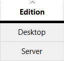
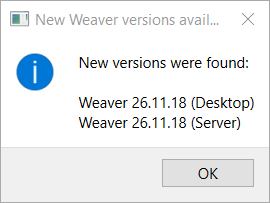
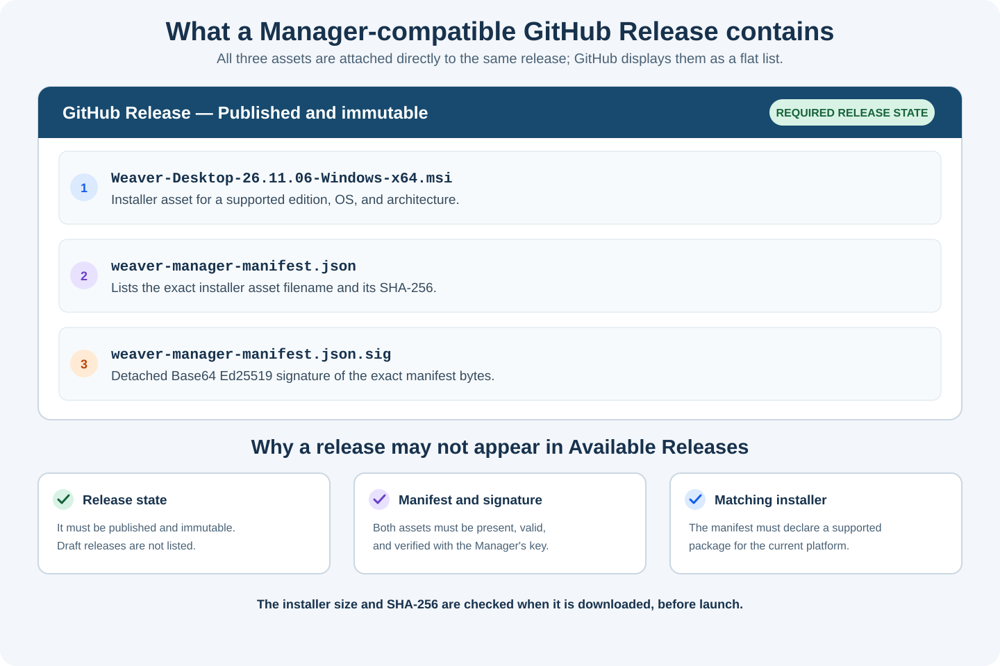
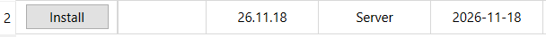
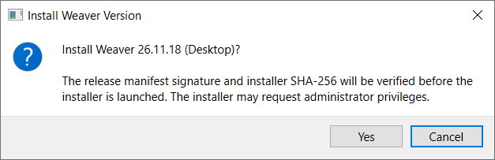
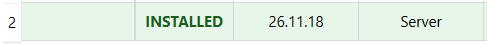

Getting Started
===============

Install Weaver Manager
----------------------

Download the Manager package for your operating system from the `Weaver Manager releases <https://github.com/jordiSpider/Weaver/releases?q=manager>`_ page and install it using the standard procedure for that platform. This page filters releases by ``manager``; select the most recent result for Weaver Manager. The repository's ``latest`` release may belong to Weaver, not the Manager.

.. tab-set::

   .. tab-item:: Windows

      The Windows installer guides you through the following phases.

      **Phase 1 — Windows Defender SmartScreen**

      The installer is not yet digitally signed, so Windows cannot verify its publisher and may display the **Windows protected your PC** warning. Continue only if you downloaded the installer from the official Weaver Manager releases page. Select **More info** (also shown as **More information** in some Windows versions), then **Run anyway**. Otherwise, cancel the installer.

      .. figure:: _static/images/installation/windows/01-smartscreen.png
         :alt: Windows Defender SmartScreen warning with the More info option.
         :width: 85%
         :align: center

         Windows Defender SmartScreen warning. Select ``More info`` to reveal ``Run anyway``.

      **Phase 2 — Administrator permission and welcome**

      Windows asks for permission to let the installer make changes to the device. Accept the prompt to continue. The installer then opens its welcome page; select **Next** to proceed.

      **Phase 3 — Software license**

      Review and accept the software license agreement, then select **Next**.

      .. figure:: _static/images/installation/windows/02-license.png
         :alt: Weaver Manager installer license agreement page.
         :width: 85%
         :align: center

         License agreement page. Review and accept the terms to continue.

      **Phase 4 — Program installation folder**

      The default program folder is ``C:\Program Files\Weaver Manager``. Keep this location or choose another, then continue.

      .. figure:: _static/images/installation/windows/03-program-folder.png
         :alt: Program installation folder page showing the default path.
         :width: 85%
         :align: center

         Program installation folder page with the default path ``C:\Program Files\Weaver Manager``.

      **Phase 5 — Program shortcut**

      Choose whether the installer should create a program shortcut, then continue.

      .. figure:: _static/images/installation/windows/04-shortcut.png
         :alt: Installer page for choosing whether to create a program shortcut.
         :width: 85%
         :align: center

         Program shortcut selection page.

      **Phase 6 — Application data folder**

      Choose where Weaver Manager should store its mutable data, installed Weaver versions, and logs. The default is ``Documents\Weaver Manager``. Keep this location or choose another folder, then continue.

      .. figure:: _static/images/installation/windows/05-data-folder.png
         :alt: Application data folder page showing the suggested Documents location.
         :width: 85%
         :align: center

         Application data folder page with the suggested ``Documents\Weaver Manager`` location.

      **Phase 7 — Install and finish**

      Select **Install** and wait for setup to complete. When the completion page appears, select **Finish** to close the installer.

      .. figure:: _static/images/installation/windows/06-complete.png
         :alt: Weaver Manager installer completion page with the Finish button.
         :width: 85%
         :align: center

         Installer completion page. Select ``Finish`` to close setup.

   .. tab-item:: macOS

      .. macOS installation instructions will be added later.

   .. tab-item:: Linux

      .. Linux installation instructions will be added later.

Weaver Manager menus
--------------------

**Notifications**

The **Notifications** menu contains two options for Weaver Manager update notifications:

* **Show update notifications** enables or disables notifications about Weaver Manager updates. It is enabled by default.
* **Notify about pre-release versions** enables or disables notifications about pre-release versions of Weaver Manager. It is disabled by default.

When enabled, update notifications are shown at startup whenever a newer version is available, unless that notification has already been dismissed. The notification includes a checkbox to stop showing it again for that version. Select the checkbox and then **OK** to dismiss the notification and automatically turn off **Show update notifications**. To receive update notifications again, re-enable **Show update notifications** from the **Notifications** menu.

These settings affect notifications about Weaver Manager only; they do not control notifications or release listings for Weaver versions.

**Help**

Select **Weaver Manager Documentation** from the **Help** menu to open the documentation for the installed Weaver Manager version in your web browser.

Find a release
--------------

Open the **Available Releases** tab. Each time Weaver Manager starts, it automatically refreshes the list of available releases from GitHub. It displays only entries that have a valid signed manifest, a matching artifact, and a package for the current platform. Select **Refresh GitHub Releases** to check again while the program is open.

Select a column heading to sort the list. The arrow in the heading shows the current sort direction; select the same heading again to reverse it.

   The ``Edition`` column is sorted in ascending order. Select the same column heading again to reverse the order.

.. div:: sd-mb-3

   The **Release status** column identifies :bdg-success:`Latest`, :bdg-primary:`Stable`, or :bdg-warning:`Pre-Release`.

   - :bdg-success:`Latest`: the most recent stable release identified by GitHub. Weaver Manager does not install it automatically.
   - :bdg-primary:`Stable`: a regular release that is not marked as a pre-release; a newer stable release may be available.
   - :bdg-warning:`Pre-Release`: a release marked by its maintainers as preliminary, usually for testing or evaluation.

**Cache status** tracks releases the Manager has discovered and versions it detects as installed. It keeps a local record of verified release version and edition pairs for the current platform; this record is separate from the temporary cache used for downloaded installer files.

When the Manager searches for releases for the first time, this record is empty, so every verified release it finds for the current platform that is not already detected as installed is marked **NEW**. On later searches, **NEW** marks releases discovered since the previous search. The Manager displays an information window listing all newly discovered versions and editions so you can decide whether to try them. The **NEW** marker is informational; it is not a recommendation or security rating, and it clears after the next refresh or when the Manager restarts.

   Information window listing the newly discovered version and edition pairs.

When the Manager detects that a version and edition are installed, **Cache status** changes to **INSTALLED** and its **Install** button is hidden to prevent installing it again. After uninstalling it, select **Refresh Installed Versions**; if its release is still available in the catalog, it can be installed again.

.. _why-a-release-may-not-appear:

Why a release may not appear
~~~~~~~~~~~~~~~~~~~~~~~~~~~~~

GitHub Release assets are attached as a flat list, not uploaded into folders. Weaver Manager lists only published, immutable releases that include both ``weaver-manager-manifest.json`` and its detached Base64 Ed25519 signature, ``weaver-manager-manifest.json.sig``, as well as a supported installer asset. Draft releases, missing files, invalid signatures, malformed manifests, and assets that do not match the current platform are omitted.

The Manager verifies the manifest using a public key pinned into the application at build time. The signed manifest must declare the installer asset and its SHA-256. The installer filename must identify a supported edition, version, operating system, and architecture, and must match the current platform.

**Supported installer names** follow this pattern:

``Weaver-<Edition>-<YY.MM.DD>-<OS>-<Architecture>.<extension>``

For example: ``Weaver-Desktop-26.11.06-Windows-x64.msi``. The edition is ``Desktop`` or ``Server``; OS is ``Windows``, ``Linux``, or ``macOS``; architecture is currently ``x64`` or ``arm64``. Supported extensions are ``msi`` on Windows, ``deb`` or ``rpm`` on Linux, and ``pkg`` or ``dmg`` on macOS.

   Example of the assets attached to a Manager-compatible GitHub Release and the catalog requirements.

Before launching an installer, the Manager checks the downloaded file's size and SHA-256 against the signed manifest and verifies the cached file again.

.. warning::

   These checks protect the catalog and installer download from unauthorized or accidental changes relative to the signing key. They do not replace operating-system security controls or independent review of a release.

See :doc:`publishing-releases` for the release preparation checklist. If this explanation does not identify why a release is missing, see :doc:`troubleshooting` for other possible causes and their solutions.

Install a version
-----------------

The verified releases for your operating system and architecture are shown in a table. Compare the **Version** and **Edition** columns to find the build you want. The **Installer** column shows the package that will be launched; other columns provide publication date, release status, and cache status.

Select **Install** in the row for the chosen version and edition.

   Select the intended version and edition, then click **Install** in that row.

Weaver Manager opens a confirmation dialog showing the selected version and edition. It explains that the release manifest signature and installer SHA-256 will be verified before the installer is launched, and that the installer may request administrator privileges. Select **Yes** to continue or **Cancel** to stop.

   Confirm the selected version after reviewing the verification and administrator-privilege notice.

The Manager validates release manifest signatures when it loads the catalog. After you confirm, it downloads the installer and checks its size and SHA-256 against the signed manifest. If the checks pass, the Manager launches the downloaded installer automatically. Follow the instructions for your operating system in the relevant tab.

.. tab-set::

   .. tab-item:: Windows

      After verification, Weaver Manager opens the downloaded Windows installer automatically. When started this way, the MSI runs in Manager-managed mode and skips the standard folder-selection pages. The Manager installs the version in an ``installed_versions`` subdirectory under each of its configured locations: the software installation directory and the mutable-data directory. These predetermined locations let Weaver Manager keep track of the installed versions and their content. You do not need to choose either path in the version installer. This differs from launching the MSI directly.

      **Welcome**

      The version installer opens at its welcome screen. Select **Next** to continue.

      .. figure:: _static/images/install-version/windows/windows-installer-welcome.png
         :alt: Welcome page of the Weaver version installer launched by Weaver Manager.
         :width: 75%
         :align: center

         The version installer opens automatically after verification. Select **Next** to continue.

      **Accept the license**

      Review the license agreement, select the option to accept its terms, and continue to the next page.

      .. figure:: _static/images/install-version/windows/windows-license-agreement.png
         :alt: License agreement page in the Weaver version installer.
         :width: 75%
         :align: center

         Accept the license agreement to continue with the installation.

      **Choose components**

      The component list depends on whether you selected the **Desktop** or **Server** edition. All components are selected by default. Select a feature's icon in the tree to open its installation-state menu. Required components cannot be excluded; optional components can also be excluded or added when modifying the installation.

      .. figure:: _static/images/install-version/windows/windows-component-selection.png
         :alt: Component selection page showing required and optional Weaver features selected by default.
         :width: 75%
         :align: center

         Component choices vary by edition; all components are selected by default.

      **Required components**

      Required components have an installation-state menu, but it does not include an option to exclude the component. Use one of the available installation options:

      .. figure:: _static/images/install-version/windows/windows-required-component-options.png
         :alt: Installation-state menu for a required Weaver component.
         :width: 50%
         :align: center

         Installation options for a required component. This menu does not include an option to exclude the component.

      * **Will be installed on local hard drive** — installs the component locally; its subcomponents can be selected separately.
      * **Entire feature will be installed on local hard drive** — installs the component and all its subcomponents locally.
      * **Feature will be installed when required** — makes the component available for installation when it is first needed.

      **Optional components**

      Optional components have the same installation options, plus an option to leave the component out of the installation. Choose **Entire feature will be unavailable** to prevent the component and its subcomponents from being installed. To add or retain the component, choose one of the installation options described above.

      .. figure:: _static/images/install-version/windows/windows-optional-component-options.png
         :alt: Installation-state menu for an optional Weaver component, including the option to leave it unavailable.
         :width: 50%
         :align: center

         Installation options for an optional component, including ``Entire feature will be unavailable``.

      Repeat this for each component you want to change, then continue with the installation.

      **Install**

      On the ready-to-install page, select **Install** to begin. Windows may then ask for permission to make changes to your device. Accept the User Account Control prompt to allow the installation to continue.

      .. warning::

         Installation time depends on the selected components and may range from a few seconds to several minutes. Wait for the installer to finish and do not close or interrupt it.

      **Finish**

      When installation is complete, the installer displays its completion page. Select **Finish** to close it.

      .. figure:: _static/images/install-version/windows/windows-installation-complete.png
         :alt: Completion page confirming that the Weaver version installation has finished.
         :width: 75%
         :align: center

         The completion page confirms that the installation has finished.

   .. tab-item:: Linux

      .. Linux installation instructions will be added later.

   .. tab-item:: macOS

      .. macOS installation instructions will be added later.

The Manager does not install silently or update an existing version in place; versions can be installed side by side. After installation, the version is added automatically to **Installed Versions**, and its **Cache status** in **Available Releases** changes to **INSTALLED**.

   The installed version is marked **INSTALLED** in the **Cache status** column.

For details about the actions available for an installed version, see :doc:`managing-versions`.

For instructions on adding and installing a local test installer, see :ref:`Local test installers <local-test-installers>`.

Logs and installer cache
------------------------

Weaver Manager stores its logs and data in the application data folder selected during installation. By default, this is ``Documents\Weaver Manager``. The folder can be in a different location if you selected one in the installer.

**Logs** are stored in the ``logs`` subfolder:

* ``weaver-manager.log`` records Manager activity and installer process output. It is appended to across Manager sessions.
* On Windows, ``msiexec-install.log`` records a managed version installation, and ``msiexec-modify.log`` records a **Modify** operation. These are verbose Windows Installer logs and can help diagnose installation or maintenance failures.

**Release and notification state** is stored separately in ``release-cache.ini`` in the platform's per-user application data folder. It records which Weaver version-and-edition pairs have already appeared in the release catalog, along with Manager update-notification preferences and dismissed notifications. This lets the Manager identify newly discovered releases and remember your notification choices. It is not a cache of the GitHub release catalog or its manifests. Removing this file resets notification preferences to their defaults; on systems with legacy saved release history, the Manager may restore that history from its older settings store.

**Verified installers** are downloaded to ``verified-installers`` in the platform's cache folder. Before launching an installer, Weaver Manager checks its size and SHA-256 against the signed release manifest and verifies the cached file again. A catalog refresh removes cached installers for releases that are no longer available for the current platform. The Manager also removes the installer cache when it closes; if an installer is still running, the Manager waits until it finishes before closing and cleaning up the cache.

The ``installed_versions`` folders contain the actual Weaver installations, not temporary cache files. Closing Weaver Manager does not remove installed versions.

