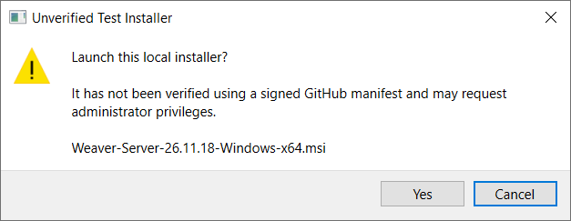
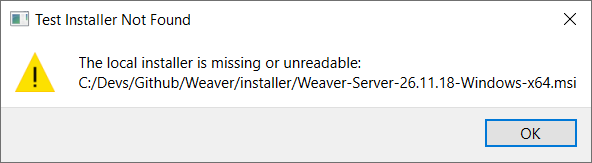

Publishing a Weaver Release
============================

Scope
-----

Weaver Manager consumes GitHub Releases. It does not build Weaver packages, create releases, generate manifests, or sign assets. This page describes how maintainers prepare and publish a release for the Manager catalog.

Each release intended for the catalog must include the platform installer assets, ``weaver-manager-manifest.json``, and its detached Base64 signature, ``weaver-manager-manifest.json.sig``. For supported installer names and formats, see :ref:`Why a release may not appear <why-a-release-may-not-appear>`.

Prepare the assets
------------------

1. Build, test, and finalize each installer. Do not modify an installer after calculating its hash.
2. Name each asset using a supported pattern described in :ref:`Why a release may not appear <why-a-release-may-not-appear>`.
3. Calculate a SHA-256 hash for every final installer:

   .. tab-set::

	  .. tab-item:: Windows

		 .. code-block:: powershell

			Get-FileHash .\Weaver-Desktop-26.11.06-Windows-x64.msi -Algorithm SHA256

	  .. tab-item:: Linux

		 .. code-block:: console

			sha256sum Weaver-Desktop-26.11.06-Linux-x64.deb

	  .. tab-item:: macOS

		 .. code-block:: console

			shasum -a 256 Weaver-Desktop-26.11.06-macOS-arm64.pkg

   Copy the resulting 64-character hexadecimal hash into the corresponding artifact entry.

4. Create a schema-version 1 manifest that lists the exact asset filenames and SHA-256 values. This minimal example shows one artifact:

   .. code-block:: json

	  {
		"schema_version": 1,
		"artifacts": [
		  {
			"asset": "Weaver-Desktop-26.11.06-Windows-x64.msi",
			"sha256": "<64-character-sha256>"
		  }
		]
	  }

   Replace the placeholder with the installer's actual 64-character hexadecimal SHA-256. See `manager/release-manifest.example.json <release-manifest-example_>`_ for a complete example with multiple artifacts.

5. Sign the manifest with the offline Ed25519 private key and Base64-encode the detached signature:

   .. code-block:: console

	  openssl pkeyutl -sign -rawin -inkey release-signing-private.pem -in weaver-manager-manifest.json -out signature.bin
	  openssl base64 -A -in signature.bin -out weaver-manager-manifest.json.sig

Do not reformat or otherwise change the manifest after signing; any byte change invalidates the signature. Keep the private key offline and outside the repository. Never commit it, upload it with a release, include it in a build artifact, or place it in a public CI secret.

Publish and verify
------------------

1. Create a draft GitHub Release and attach all installer assets, the manifest, and its detached signature.
2. Check that every manifest filename exactly matches an attached installer and that each hash was calculated from the final file.
3. Verify the detached signature against the final manifest using the public key in the Manager build.
4. Review the complete asset set, then publish only when all checks pass and release immutability is enabled for the repository.
5. Test catalog discovery and installation with a Manager build containing the matching public key.

Treat published immutable assets as final. If an asset or manifest is wrong, prepare a corrected release rather than relying on replacing published files.

Public-key configuration and rotation
--------------------------------------

The Manager's public verification key is pinned at build time. CMake reads ``manager/release-signing-public.pem`` by default (PEM or DER input is supported) or can use ``WEAVER_RELEASE_PUBLIC_KEY_BASE64`` as a fallback override. Commit only the public key. If the signing key changes, build and distribute a Manager version containing the new public key in coordination with release publication; otherwise, the catalog will reject signatures from the new key.

.. _local-test-installers:

Local test installers
---------------------

The **Add Test Installer** control is available only in a Manager build configured with ``ENABLE_TEST=ON``. It adds a package from the local machine to the **Available Releases** table for testing; it does not publish the package or make it available to other users.

Add a local test installer
~~~~~~~~~~~~~~~~~~~~~~~~~~

1. In **Available Releases**, select **Add Test Installer**. In the dialog, choose **Browse…**, enter or paste a file path, or drag and drop one installer file into the drop area. Select **Add Installer** to continue.

   .. figure:: _static/images/publishing-releases/local-test-installers/add-installer-dialog.png
	  :alt: Add Local Test Installer dialog with Browse, path entry, drag-and-drop area, and Add Installer button.
	  :width: 80%
	  :align: center

	  The **Add Local Test Installer** dialog accepts one package selected with **Browse…**, entered as a path, or dragged into the dialog.

2. The Manager checks that the file exists, is readable, has an extension supported on the current operating system, and has a supported filename matching the current platform. See :ref:`Why a release may not appear <why-a-release-may-not-appear>` for the supported package names and formats. An invalid package or filename is rejected with an **Invalid Test Installer** or **Invalid Test Installer Name** warning.

   .. figure:: _static/images/publishing-releases/local-test-installers/invalid-installer-warnings.png
	  :alt: Invalid Test Installer and Invalid Test Installer Name warning dialogs shown when a local package cannot be added.
	  :width: 75%
	  :align: center

	  These warnings explain whether the package is unreadable or has an unsupported extension, or whether its filename does not match the current platform.

3. After a successful addition, the package appears in the table with its version and edition, **Local** as its installer source, **Test** as its status, and an **Install** button.

   .. figure:: _static/images/publishing-releases/local-test-installers/test-installer-row.png
	  :alt: Available Releases table showing a locally added test installer with Test status and an Install button.
	  :width: 90%
	  :align: center

	  A successfully added local package is marked **Test** and can be launched with its **Install** button.

Install a local test installer
~~~~~~~~~~~~~~~~~~~~~~~~~~~~~~

Select **Install** for the test entry. Before launching the package, the Manager displays an **Unverified Test Installer** warning: the installer was not verified using a signed GitHub manifest and may request administrator privileges. **Cancel** is selected by default; choose **Yes** only if the package came from a trusted source.

   Review the verification and administrator-privilege warning before choosing **Yes** to launch the local installer.

If the package has been moved, deleted, or become unreadable, the Manager displays a **Test Installer Not Found** warning and removes the entry from the table. If the operating system cannot start the installer, a **Could Not Start Test Installer** warning displays the launch error.

   The Manager reports a missing or unreadable local package, or an error when the operating system cannot start it.
