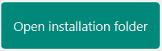
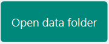
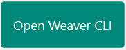
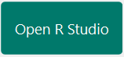
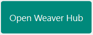
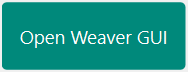
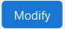
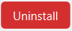

Managing Installed Versions
============================

Available actions
-----------------

All installed versions appear as a list in the **Installed Versions** tab. Each version has its own entry with a set of action buttons for opening or managing that installation. Expand **Actions** to show the available shortcuts.

.. warning::

   An action button is shown only when the installed version meets its requirements. If a version does not meet a button's requirements, that action will not appear in its available actions.

Common actions
~~~~~~~~~~~~~~

The following actions are available across operating systems. Some are shown only for **Desktop** editions or when the required application or feature is installed.

Open installation folder
^^^^^^^^^^^^^^^^^^^^^^^^

* **Button image:** |button-open-installation-folder|
* **Desktop edition required:** :bdg-success:`No`
* **Required programs:** :bdg-success:`None`
* **Required components:** :bdg-success:`None`
* **Functionality:** Opens the folder containing the installed program files.

Open data folder
^^^^^^^^^^^^^^^^

* **Button image:** |button-open-data-folder|
* **Desktop edition required:** :bdg-success:`No`
* **Required programs:** :bdg-success:`None`
* **Required components:** :bdg-success:`None`
* **Functionality:** Opens the mutable-data folder for this version and edition, when it exists.

Open Weaver CLI
^^^^^^^^^^^^^^^

* **Button image:** |button-open-weaver-cli|
* **Desktop edition required:** :bdg-success:`No`
* **Required programs:** :bdg-success:`None`
* **Required components:** :bdg-success:`None`
* **Functionality:** Opens the installed CLI in a terminal: Command Prompt on Windows, Terminal.app on macOS, or an available Linux terminal emulator such as GNOME Terminal, Konsole, XFCE Terminal, or xterm. On Linux, a supported terminal emulator must be installed. The terminal remains open after the CLI exits so you can review its output.

Open R Studio
^^^^^^^^^^^^^

* **Button image:** |button-open-r-studio|
* **Desktop edition required:** :bdg-success:`No`
* **Required programs:** :bdg-warning:`R`
* **Required components:** :bdg-warning:`R packages`
* **Functionality:** Launches R with the selected installation's private R library. R must be installed and discoverable on the system.

Open Weaver Hub
^^^^^^^^^^^^^^^

* **Button image:** |button-open-weaver-hub|
* **Desktop edition required:** :bdg-warning:`Yes`
* **Required programs:** :bdg-warning:`R 4.2 or newer`
* **Required components:** :bdg-warning:`R packages`
* **Functionality:** Opens Weaver Hub. The R package must be installed, and R 4.2 or newer with a discoverable ``Rscript`` executable is required.

Open Weaver GUI
^^^^^^^^^^^^^^^

* **Button image:** |button-open-weaver-gui|
* **Desktop edition required:** :bdg-warning:`Yes`
* **Required programs:** :bdg-success:`None`
* **Required components:** :bdg-warning:`Weaver Graphical Interface`
* **Functionality:** Opens Weaver GUI. The graphical-interface feature must be installed.

Operating-system-specific actions
~~~~~~~~~~~~~~~~~~~~~~~~~~~~~~~~~~

The following actions depend on the operating system.

.. tab-set::

   .. tab-item:: Windows

	  **Modify**

	  * **Button image:** |button-modify|
	  * **Desktop edition required:** :bdg-success:`No`
	  * **Required programs:** :bdg-success:`None`
	  * **Required components:** :bdg-success:`None`
	  * **Functionality:** Opens Windows Installer maintenance for the selected version, where you can change its installed components.

	  **Uninstall**

	  * **Button image:** |button-uninstall|
	  * **Desktop edition required:** :bdg-success:`No`
	  * **Required programs:** :bdg-success:`None`
	  * **Required components:** :bdg-success:`None`
	  * **Functionality:** Asks for confirmation, then removes the selected version through Windows Installer.

   .. tab-item:: Linux

	  .. Linux-specific actions will be documented here.

   .. tab-item:: macOS

	  .. macOS-specific actions will be documented here.
